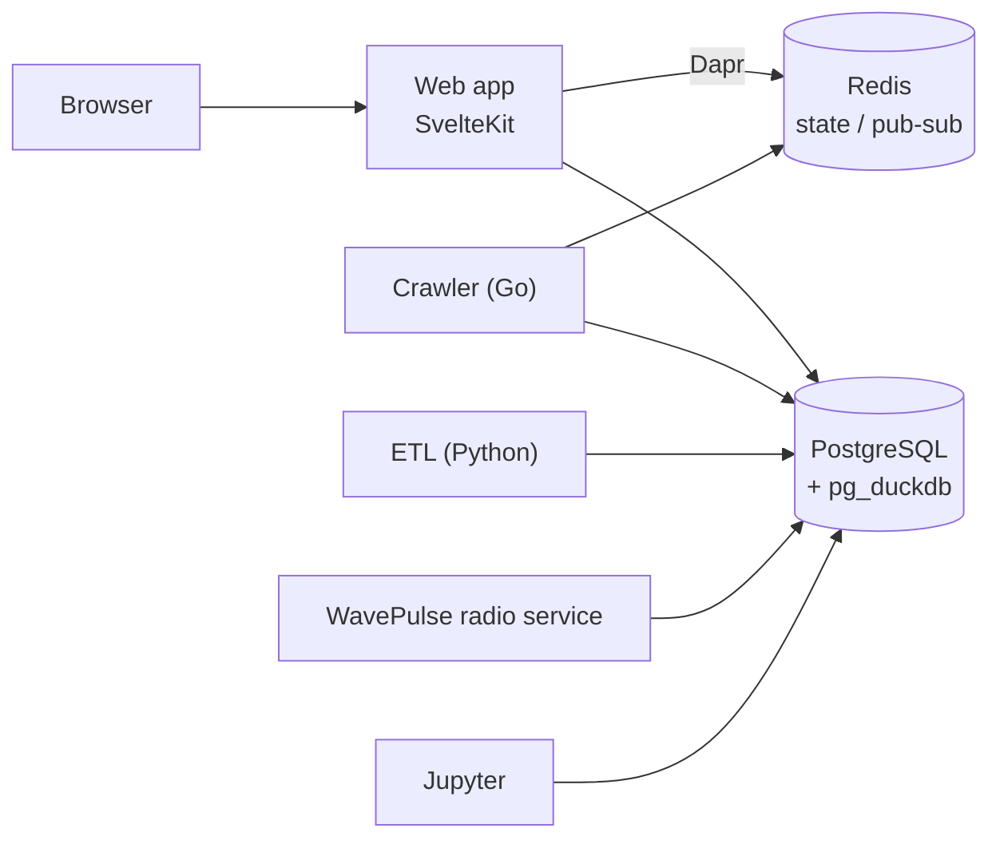

# Social Explorer

[](https://github.com/spiculedata/social-explorer/actions/workflows/test.yml)
[](LICENSE)

A social media research platform: collect posts from several platforms, load them into one
analytics database, and explore them through dashboards, investigations and notebooks.

> **Status: early, pre-1.0.** The platform is under active development. Interfaces and the
> database schema may change, and some modules (for example the workflow builder) are
> experimental. Run it on a trusted network until you have reviewed the
> [security notes](SECURITY.md).

## What it does

- **Collect.** A Go crawler gathers Telegram, YouTube and Bluesky content on a schedule; ETL
  pipelines load datasets such as GDELT; a radio service records and transcribes broadcasts.
- **Analyse.** Sentiment and emotion, topic modelling, language detection, engagement, GDELT
  events and Android usage analytics, with cross-module views over the same posts.
- **Explore.** Interactive dashboards (ECharts, Leaflet), keyword-highlighted investigations of
  transcripts, and embedded Jupyter notebooks.
- **Organise.** Projects and workspaces keep datasets separate. Accounts have admin, user and
  viewer roles.
- **Share.** Hand a collaborator, a reviewer or a journal the dataset behind your findings as one
  content ID: an open Frictionless Data Package (CSV plus a schema) published over the IPFS
  peer-to-peer network, which opens in Python, R or Excel and always resolves to the same bytes, so
  a paper can cite the exact version used. Import a colleague's package by ID into a table you can
  query. Off by default and admin-only: anything published is public, stays available only while a
  node holds a copy, and cannot be withdrawn, so it is for open, anonymised data only. See
  [Data sharing over IPFS](https://spiculedata.github.io/social-explorer/guide/data-sharing).

## Architecture



| Directory | Role |
|-----------|------|
| [`ex-accell-ui/`](ex-accell-ui) | SvelteKit 2 / Svelte 5 web app and API (TypeScript, Tailwind CSS 4) |
| [`etl/`](etl) | Python data pipelines |
| [`crawler/`](crawler) | Go crawler for Telegram, YouTube and Bluesky |
| [`wavepulse/`](wavepulse) | Radio recording and transcription, derived from [NYU WavePulse](https://github.com/NYU-DICE-Lab/WavePulse) |
| [`jupyter/`](jupyter) | Jupyter Lab environment |
| [`deploy/`](deploy), [`docker-compose.yml`](docker-compose.yml) | Dapr components and the compose stack |
| [`docs-site/`](docs-site) | Documentation site source (VitePress) |

## Try it in one command

Needs Node 22 and Docker. This starts a throwaway database, loads synthetic demo data about a
fictional city and runs the app on <http://localhost:5173>, reachable only from your machine:

```bash
git clone https://github.com/spiculedata/social-explorer.git
cd social-explorer/ex-accell-ui
npm run demo
```

The sign-in is printed in the terminal. `npm run demo -- --stop` stops the database and
`npm run demo -- --reset` deletes it (then run `npm run demo` for a fresh one).

## Quickstart

To run the full stack yourself, you need [Docker](https://docs.docker.com/get-docker/) with Compose v2.

```bash
git clone https://github.com/spiculedata/social-explorer.git
cd social-explorer

cp .env.example .env
# Edit .env: set SESSION_SECRET (openssl rand -hex 32), ADMIN_PASSWORD (12+ characters)
# and change POSTGRES_PASSWORD.

docker compose up -d --build postgres redis dapr-placement ui ui-dapr
```

Open <http://localhost:3000> and sign in with `ADMIN_EMAIL` / `ADMIN_PASSWORD` from your `.env`.
The first admin account is created automatically when the user table is empty.

The command above starts only the core stack. The remaining services in `docker-compose.yml`
(Ollama, Jupyter, WavePulse, the crawler, ETL) are optional and need extra setup; see the
documentation.

The first sign-in creates the database schema. A fresh database has no data, so dashboards show
empty states until you load some; `npm run seed:demo` loads a synthetic demo dataset (see
[Try it with demo data](docs-site/guide/demo-data.md)).

### Troubleshooting

- **`port is already allocated` for 50006.** A local `dapr init` already runs a container on that
  port. Stop it (`docker stop dapr_scheduler`) or leave `dapr-placement` out of the command; the web
  app works without it, but Dapr features will not.
- **`SESSION_SECRET` error on start.** The secret is required. Generate one with
  `openssl rand -hex 32` and put it in `.env`.
- **Login does not stick over plain HTTP.** Keep `COOKIE_SECURE=false` for `http://localhost`, and
  set it to `true` only when serving over HTTPS.
- **Data lives in `./data`.** Set `DATA_DIR` in `.env` to move it. Remove the directory to reset.

## Development

```bash
cd ex-accell-ui
npm ci
npm run dev        # needs a PostgreSQL with pg_duckdb; see CONTRIBUTING.md
npm run test:unit  # unit tests (Vitest)
npm run check      # type check
```

[CONTRIBUTING.md](CONTRIBUTING.md) covers the database container for local development, the full
set of checks and commit conventions.

## Documentation

- Documentation site: <https://spiculedata.github.io/social-explorer/>
- Source for the site lives in [`docs-site/`](docs-site); run `npm run docs:dev` inside it to preview.

## Security

Please report vulnerabilities privately; see [SECURITY.md](SECURITY.md).

## License

Apache License 2.0. See [LICENSE](LICENSE) and [NOTICE](NOTICE). The `wavepulse/` directory is
derived from NYU's WavePulse and carries its own notices, including a note about a pending patent
application; read [`wavepulse/NOTICE`](wavepulse/NOTICE) before commercial use.
